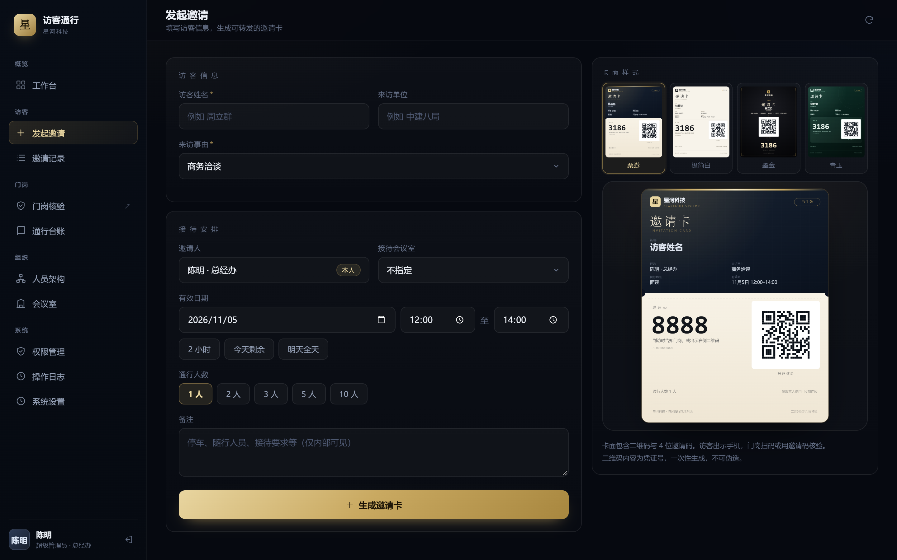
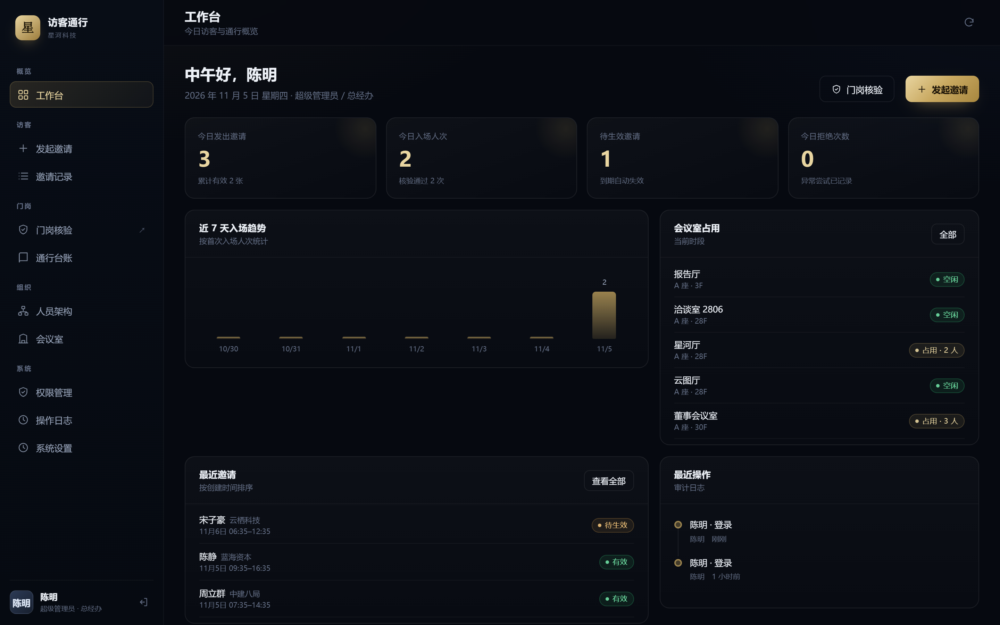
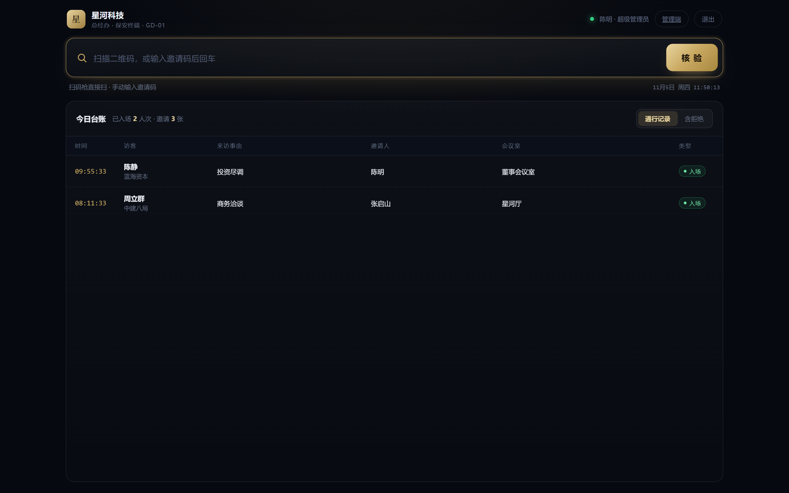
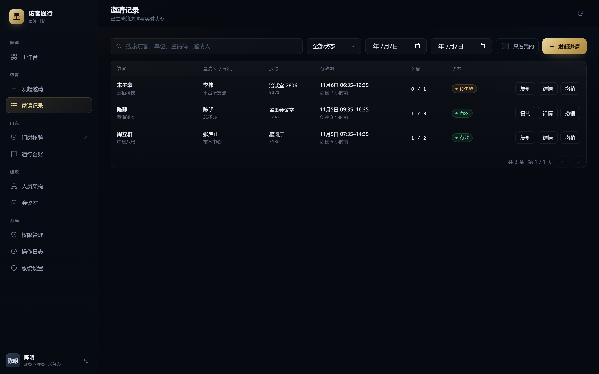
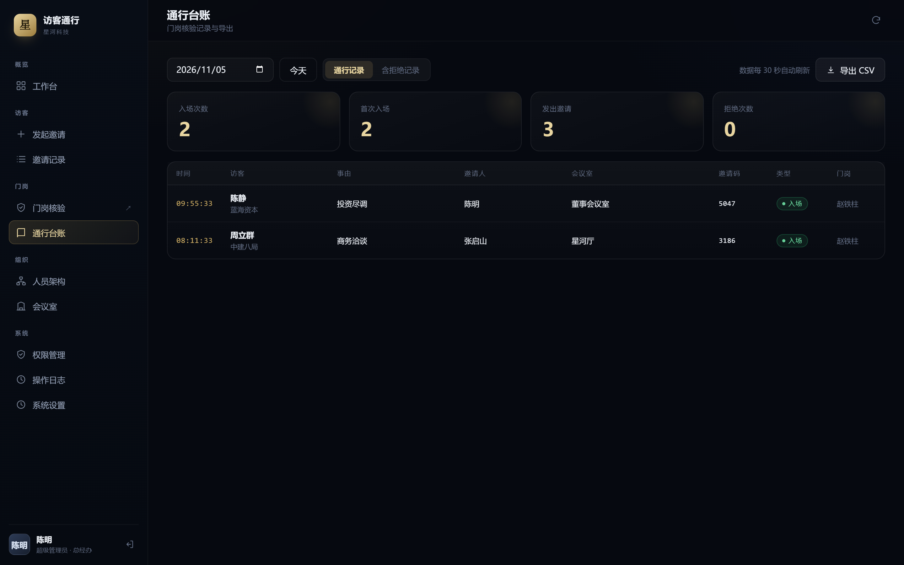

<div align="center">

# Visitor Pass

**Not an approval. An invitation.**

A zero-dependency, offline-capable visitor invitation and gate verification system.
Node 16+, run `node server.js`. No `npm install`, no database, no internet required.

[](LICENSE)
[](https://nodejs.org)
[](#architecture)

[Philosophy](#why-invitation) · [Quick start](#quick-start) · [Screenshots](#screenshots) · [中文](README.md)

</div>



---

## Why invitation

Most visitor systems assume **approval**: the visitor applies, an employee clicks "approve", a guard interrogates at the door.

Everyone in that chain is guarding against everyone else. The visitor feels like a supplicant. The guard feels like a bouncer. The host feels like they created a chore.

This system assumes **invitation**: you invite them.

- Fill four fields, generate a card, copy the image, send it over WeChat.
- The guest receives a card with their name, date, meeting room and host. No sign-up, no app, no form.
- They show the card at the gate. The guard scans it. Two seconds.
- The ledger writes itself.

Client, supplier, candidate, competitor — if they were invited, they are treated as a guest. That is not a slogan; it is enforced in the permission model: the inviter is always the currently authenticated account, and the server rejects any client-supplied identity. Whoever invites, owns the responsibility.

| | Approval-based (typical) | Invitation-based (this project) |
|---|---|---|
| Who initiates | Visitor applies, employee approves | Employee invites, visitor accepts |
| How it feels | I am asking a favour | I was invited |
| Guard's role | Interrogator | Verifier |
| Accountability | Diffuse | The inviter, traceably |
| Guest installs | Mini-program / app / follow an account | Nothing. It's just an image. |
| Data lives | Vendor cloud | Your own machine |

Full essay: [docs/PHILOSOPHY.md](docs/PHILOSOPHY.md) (Chinese).

---

## Screenshots

| Dashboard | Guard terminal |
|---|---|
|  |  |

| Invitation records | Ledger |
|---|---|
|  |  |

---

## Quick start

```bash
git clone https://github.com/bulusiLive/visitor-pass.git
cd visitor-pass
node server.js
```

```
  Visitor Pass  started
  ─────────────────────────────────────
  Admin     http://127.0.0.1:8080/
  Guard     http://127.0.0.1:8080/guard
  Data      .../data/db.json
  Account   admin / admin123
```

On Windows you can simply double-click `start.bat`.

Environment variables: `PORT` (default `8080`), `HOST` (default `0.0.0.0`).

Seed accounts (`admin/admin123`, `zhang.qishan/vp123456`, `guard01/vp123456`, …) are created on first boot. **Change them before any real use.**

---

## Features

- **Invitation workflow** — guest, company, purpose, meeting room, validity window, headcount, notes. Card preview updates live.
- **Four card designs** — ticket, minimal, noir, jade. 1080×1350, one-click copy to clipboard, paste straight into WeChat.
- **Guard terminal** — a single input box shared by barcode scanner and keyboard, enter to verify. Audible pass/fail tones. Bottom toast instead of a blocking modal, so the input is never covered.
- **Ledger** — per-day view, deny records toggle, CSV export with UTF-8 BOM so Excel opens it correctly.
- **Organisation** — multi-level department tree, members, roles, password reset, deactivation.
- **Permissions** — 16 permissions × role matrix, three data scopes (self / department and below / all).
- **Audit log** — login, invite, revoke, extend, org changes, ledger export, with IP.
- **Meeting rooms** — occupancy is derived from invitations, not a separate booking table.

---

## Design trade-offs

Open-source projects usually fail by trying to do everything. This one deliberately does **not**:

- **No door hardware.** No turnstile protocol, no face recognition, no ID reader. Hardware turns a zero-cost same-day deployment into a two-week construction project.
- **No guest app.** A guest should not install software to visit you once. The invitation is a PNG: sendable, savable, printable.
- **No multi-tenant cloud.** Data is one JSON file on the customer's machine. Copy it and you have everything.
- **No database.** Atomic writes (`.tmp` + rename), daily backups kept 7 days, corrupt-file recovery. Swap `lib/store.js` for SQLite when you outgrow it; business code stays untouched.
- **No "AI".** A gate needs an answer in 200 ms, not a visitor persona dashboard.

---

## Architecture

```
server.js             HTTP routing, static files, auth entry
lib/store.js          file storage: atomic write, daily backup, v1 migration
lib/auth.js           password hashing, sessions, permissions, login throttling
lib/org.js            department tree, members, roles
lib/rooms.js          meeting rooms and occupancy conflicts
lib/invite.js         invitations, verification, ledger, dashboard
lib/audit.js          audit log
lib/seed.js           first-boot seed data
public/               admin shell, app logic, guard terminal
```

**Dependencies: zero.** Only Node's built-in `http`, `fs`, `crypto`, `path`, `os`, `url`.
QR rendering uses [qrcode.js](https://github.com/davidshimjs/qrcodejs) (MIT), vendored in `public/assets/vendor/`.

**Verification order** (fixed on purpose — a configurable order is how you get security incidents):

1. Rate limited → `too many attempts`
2. Credential exists → `invalid`
3. Revoked → `revoked`
4. Inside validity window → `not yet valid` / `expired`
5. Same device within 60 s → pass, no headcount consumed
6. Headcount available → pass, consume 1
7. Full but re-entry allowed → pass, no consumption; otherwise → `quota exhausted`

---

## Known limitations

Written down rather than hidden:

- A 4-digit invite code is guessable in theory. Rate limiting plus the `SL`+10-digit credential inside the QR code is the real check; manual entry is the fallback.
- Re-entry is allowed by default after the quota is used up, because the system cannot distinguish "same person back from lunch" from "someone forwarded the image".
- Clipboard write requires a secure context. On LAN `http://192.168.x.x` browsers block it; the UI falls back to right-click → copy image, plus PNG download.
- No `Secure` cookie flag — it would break plain-http LAN deployments.
- No turnstile / access-control hardware integration.
- CSV, not xlsx.
- Single process. Designed for one building, a few hundred visitors per day.

---

## License

**AGPL-3.0-or-later** — see [LICENSE](LICENSE).

Use it, modify it, distribute it. If you run a modified version as a network service for third parties, you must publish your changes.

MIT was considered and rejected: the whole point is that the data stays in the customer's hands. A permissive license would let someone turn it into a closed SaaS and erase that guarantee.

**Commercial licensing** is available for closed-source integration, white-label OEM, or procurement constraints. See [COMMERCIAL.md](COMMERCIAL.md).

---

<div align="center">

**You invited me, so treat me as a guest.**
Client, supplier, or competitor.

</div>
