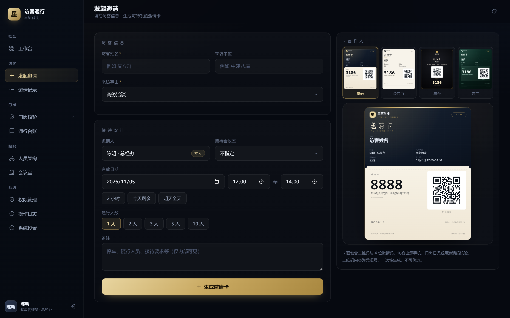
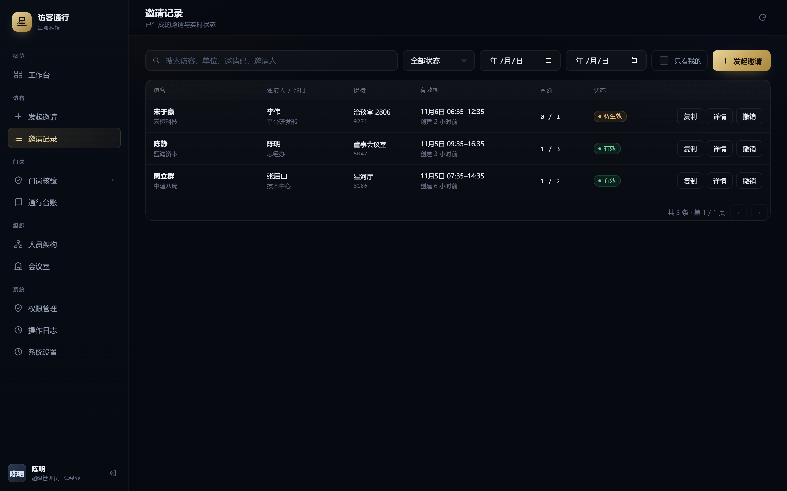
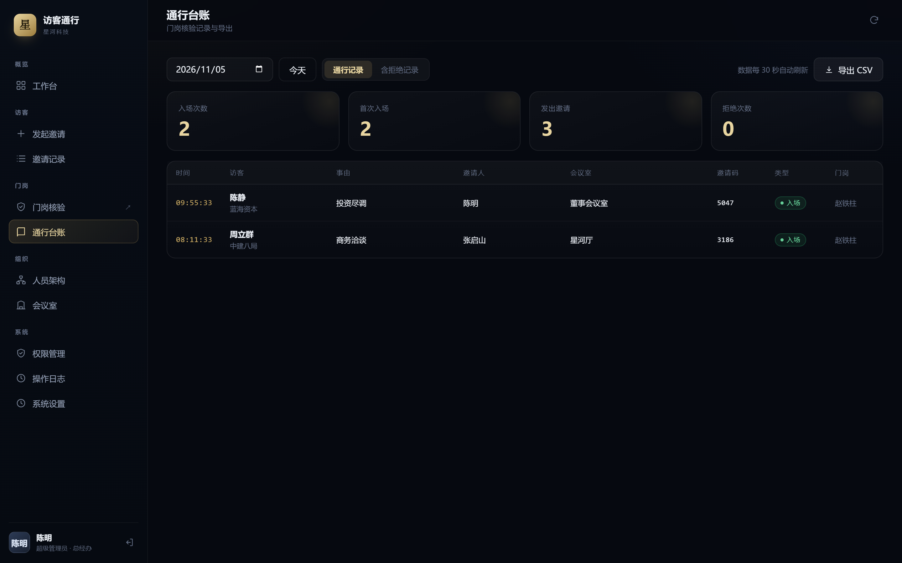
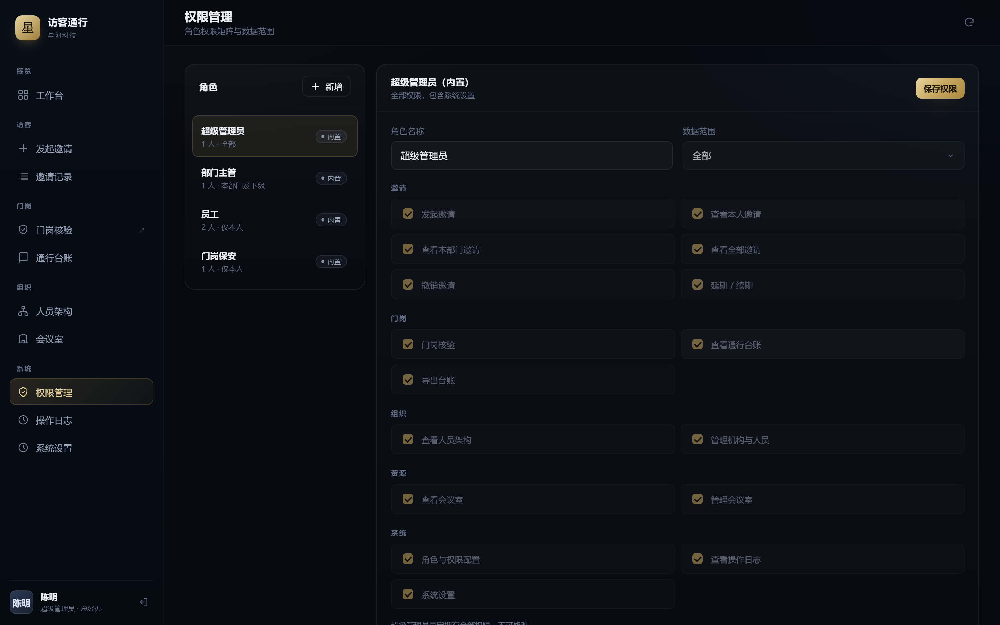

<div align="center">

# 访客通行 · Visitor Pass

**不是审批，是邀请。**

一个零依赖、可离线运行的访客邀请与门岗核验系统。
Node 16+，`node server.js` 就能跑，不需要 `npm install`，不需要数据库，不需要联网。

[](LICENSE)
[](https://nodejs.org)
[](#技术架构)

[理念](#为什么是邀请制) · [快速开始](#30-秒跑起来) · [截图](#它长什么样) · [功能](#功能) · [部署](docs/DEPLOY.md) · [English](README.en.md)

</div>



▶ **[57 秒演示视频](docs/video/visitor-pass-demo.mp4)**（横版 1920×1080 ｜ [竖版 1080×1920](docs/video/visitor-pass-demo-vertical.mp4)）
无配音，字幕已烧录，可直接加 BGM 二次剪辑。字幕轨见 [.srt](docs/video/visitor-pass-demo.srt)，旁白稿见 [narration.md](docs/video/narration.md)。

---

## 为什么是邀请制

绝大多数访客系统的默认动作是「审批」：访客填表申请，员工在系统里点通过，保安在门口盘问，最后放行。

这条链路里，每个人都在防着对方。访客像来求人办事的，保安像在查户口的，邀请人像在给自己找麻烦。

这套系统的默认动作是「邀请」：你邀请他来。

- 你填四个字段，生成一张卡，复制图片，微信发过去；
- 他收到一张有名字、有日期、有会议室、有邀请人的卡，不需要注册、不需要下载、不需要填表；
- 他到门口出示卡，保安扫码，2 秒放行；
- 台账自动生成，谁进来过一查就有。

**客户、供应商、面试者、竞争对手——只要是被邀请的，就按客人对待。**
这不是一句文案，它是权限设计：发起邀请的人固定为当前登录账号本人，服务端不接受前端指定他人。谁请的客，责任就是谁的。

| | 审批制（常见做法） | 邀请制（本项目） |
|---|---|---|
| 谁发起 | 访客申请，员工审批 | 员工邀请，访客接受 |
| 访客感受 | 我是来求人的 | 我是被请来的 |
| 门岗角色 | 盘问者 | 核验者 |
| 责任归属 | 保安担责，说不清 | 邀请人担责，可追溯 |
| 访客要装什么 | 小程序 / App / 关注公众号 | 什么都不用装，收一张图 |
| 数据在哪 | 平台方的云 | 你自己的机器 |

关于这个理念的完整论述，见 [docs/PHILOSOPHY.md](docs/PHILOSOPHY.md)。

---

## 它长什么样

### 工作台
今日邀请、入场人次、待生效、拒绝次数，近 7 天趋势，会议室实时占用。


### 门岗端
整块屏幕只有三样东西：一个输入框、一句提示、一张当日台账。扫码枪和手输共用一个框，回车即核验。


### 邀请记录与台账
按状态、日期、关键字筛选；数据范围按角色隔离——员工只看自己，主管看本部门及下级，管理员看全部。





### 人员架构与权限
部门树支持多级；16 项权限 × 角色矩阵；三种数据范围。




---

## 30 秒跑起来

**Windows：** 双击 `start.bat`。

**macOS / Linux / 任意平台：**

```bash
git clone https://github.com/ZhiGangLive/visitor-pass.git
cd visitor-pass
node server.js
```

看到这段就成功了：

```
  访客通行管理系统  已启动
  ─────────────────────────────────────
  管理端    http://127.0.0.1:8080/
  保安端    http://127.0.0.1:8080/guard
  局域网    http://192.168.1.10:8080/   (WLAN)
  ─────────────────────────────────────
  数据文件  .../data/db.json
  初始账号  admin / admin123
```

| 入口 | 地址 | 给谁用 |
|---|---|---|
| 管理端 | `http://IP:8080/` | 员工发邀请、行政查台账、管理员配权限 |
| 门岗端 | `http://IP:8080/guard` | 保安，只有「一个输入框 + 台账」 |

环境变量：`PORT`（默认 8080）、`HOST`（默认 0.0.0.0）。

**初始账号**（首次启动自动写入，正式使用前必须改密码）：

| 账号 | 密码 | 姓名 | 角色 |
|---|---|---|---|
| `admin` | `admin123` | 陈明 | 超级管理员 |
| `zhang.qishan` | `vp123456` | 张启山 | 部门主管 |
| `li.wei` | `vp123456` | 李伟 | 员工 |
| `wang.fang` | `vp123456` | 王芳 | 员工 |
| `guard01` | `vp123456` | 赵铁柱 | 门岗保安 |

> 演示数据里的「星河科技」是虚构组织，改 `lib/seed.js` 或登录后在「系统设置」里换成你自己的名字。

---

## 功能

**登录与账号**
scrypt 加盐哈希，服务端不存明文；会话存 HttpOnly Cookie，默认 12 小时，「30 天免登录」可延长；同账号 + IP 连续 5 次密码错误锁 5 分钟；改密后该账号所有设备会话立即失效；新账号首次登录提示改初始密码。

**发起邀请**
访客、单位、来访事由（常用项下拉 + 自定义）、会议室、有效期、通行人数、备注。邀请人固定为当前登录账号本人。会议室时段冲突会拦下来，确认后仍可使用。右侧卡面实时预览。

**邀请记录**
按状态 / 日期 / 关键字 / 只看我的筛选；复制卡面、查看详情、撤销、延期。数据范围按角色隔离。

**通行台账**
按日期查，含拒绝记录开关，导出 CSV（带 UTF-8 BOM，Excel 双击不乱码）。

**门岗端**
扫码枪、手动输入走同一个框，回车即核验。核验结果用底部浮动卡提示（通过 2.4 秒自动收起，拒绝停留 6 秒），配双高音 / 双低音提示音。同一设备 60 秒内重复扫同一张不重复扣人次；同 IP + 设备 2 分钟内失败 12 次冷却 60 秒。

**人员架构 / 会议室 / 权限 / 审计**
部门树、成员与角色、密码重置、停用删除；会议室增删改与当日占用（占用直接来自邀请，不单独维护预订表）；16 项权限 × 角色矩阵 + 三种数据范围；登录、发函、撤销、延期、人员/部门/角色/会议室变更、导出台账全部留痕，含 IP。

### 四种卡面

同一套数据、同一尺寸（1080×1350），样式随邀请落库，换样式不改邀请码、二维码和有效期。

| 样式 | 特征 | 适合 |
|---|---|---|
| 票券 `ticket` | 深色票面 + 暖纸色票根，撕口与虚线撕线 | 默认，微信里最像「一张票」 |
| 极简白 `minimal` | 米白底、细黑线、单一金色短规 | 打印、正式函件 |
| 墨金 `noir` | 全深色、金线边框、对称构图 | 接待重要客户 |
| 青玉 `jade` | 深青底、玉石圆环、叠层码面 | 想显得不那么「行政」 |

---

## 设计取舍

开源项目最容易犯的错是什么都做。这套系统明确**不做**下面几件事，每一件都是主动放弃：

**不接门禁硬件。** 不做闸机协议、不做人脸识别、不做身份证读卡器。一旦接硬件，部署成本从 0 变成两三万，上线周期从「今天」变成「等施工队」，客户就从「一个物业经理能拍板」变成「要过采购流程」。现在它只需要一台能开机的电脑和一个浏览器。

**不做访客 App，不做小程序。** 访客不该为一次来访安装任何东西。邀请卡就是一张 PNG，微信能发、能存、能打印、能截图。这是「尊重」在工程上的具体形状：把成本留给自己，不要转嫁给客人。

**不做云端多租户。** 数据在客户自己的机器上，`data/db.json` 一个文件，拷走就是全部。这既是隐私立场，也是部署优势——断网的大楼、不许上云的单位，都能用。

**不用数据库。** 单文件 JSON + 原子写（先写 `.tmp` 再改名，断电不会写出半个文件）+ 每日自动备份保留 7 天 + 解析失败自动起空库。日均几百条，十年也就几十 MB。真要上量，把 `lib/store.js` 换成 SQLite，业务代码一行不用改。

**不做「智能」。** 门岗需要的是 200 毫秒出结果，不是访客画像和趋势预测。

---

## 技术架构

```
server.js             HTTP 路由、静态资源、鉴权入口（589 行）
lib/store.js          文件型存储：原子写、每日备份、v1 数据迁移
lib/auth.js           口令、会话、权限判定、登录限流
lib/org.js            部门树、成员、角色
lib/rooms.js          会议室与占用冲突
lib/invite.js         邀请、核验、台账、看板
lib/audit.js          操作日志
lib/seed.js           首次启动初始化
public/index.html     管理端外壳
public/assets/app.js  管理端全部页面逻辑
public/guard.html     门岗端（独立页面，自带样式与脚本）
data/db.json          全部业务数据（已在 .gitignore 中排除）
```

**依赖：0 个。** 只用 Node 内置的 `http` / `fs` / `crypto` / `path` / `os` / `url`。
二维码渲染使用 [qrcode.js](https://github.com/davidshimjs/qrcodejs)（MIT），已内置在 `public/assets/vendor/`。

**核验判定顺序**（固定，不可配置——可配置的判定顺序是安全事故的源头）：

1. 是否命中限流 → `尝试过于频繁`
2. 凭证是否存在 → `无效凭证`
3. 是否已撤销 → `邀请已撤销`
4. 是否在时间窗内 → `尚未生效` / `已过期`
5. 同设备 60 秒内重复扫 → 放行，不扣人次
6. 名额未满 → 放行，扣 1 人次
7. 名额已满且允许复入 → 放行，不扣人次；不允许 → `名额已用尽`

---

## 接口

| 方法 | 路径 | 说明 |
|---|---|---|
| POST | `/api/auth/login` | 登录，写 HttpOnly Cookie |
| POST | `/api/auth/logout` | 退出 |
| GET | `/api/auth/me` | 当前用户 + 权限 |
| POST | `/api/auth/password` | 改自己的密码 |
| GET | `/api/bootstrap` | 前端启动所需的基础数据 |
| GET | `/api/dashboard` | 看板 |
| GET/POST | `/api/invites` | 列表 / 创建 |
| GET | `/api/invites/:token` | 单条 |
| POST | `/api/invites/:token/revoke` | 撤销 |
| POST | `/api/invites/:token/extend` | 延期 |
| POST | `/api/invites/:token/style` | 更换卡面 |
| POST | `/api/verify` | 核验，门岗唯一入口 |
| GET | `/api/ledger?date=&include=deny` | 台账 |
| GET | `/api/ledger.csv?date=` | 导出 CSV |
| GET/POST/PATCH/DELETE | `/api/departments` | 部门 |
| GET/POST/PATCH/DELETE | `/api/users` | 成员 |
| POST | `/api/users/:id/reset-password` | 重置密码 |
| GET/POST/PATCH/DELETE | `/api/roles` | 角色与权限 |
| GET/POST/PATCH/DELETE | `/api/rooms` | 会议室 |
| GET | `/api/rooms/schedule?date=` | 当日占用 |
| GET | `/api/audit` | 操作日志 |
| POST | `/api/settings` | 组织信息 |
| GET | `/api/health` | 健康检查（无需登录） |

核验返回：

```json
{ "pass": true,  "kind": "first",   "kindText": "首次入场" }
{ "pass": true,  "kind": "reentry", "kindText": "复入放行" }
{ "pass": true,  "kind": "dup",     "kindText": "重复扫描" }
{ "pass": false, "code": "expired", "word": "已过期", "reason": "…", "suggestion": "…" }
```

---

## 部署

内网、单机、Windows 服务、HTTPS、反向代理，见 [docs/DEPLOY.md](docs/DEPLOY.md)。
最短路径：`nssm install VisitorPass node server.js`，开机自启，关窗口不停服。

---

## 安全说明与已知边界

这些是**真实存在的限制**，写在这里而不是藏起来：

- **4 位邀请码理论上可猜。** 已加失败限流，但真正的强校验是二维码里的凭证号（`SL` + 10 位）。门岗优先扫码，手输是兜底。
- **复入放行默认开启。** 名额用满后仍放行并标记「复入」，因为系统拿不到身份信息，区分不了「同一个人出去吃饭回来」和「另一个人拿转发图来」。要收紧：创建邀请时把 `allowReentry` 置 false（目前只能在数据层设置）。
- **局域网 http 下剪贴板不可用。** 浏览器只在安全上下文（localhost / https）开放剪贴板写入。被拦时会弹大图并提示「右键 → 复制图像」，另有「下载 PNG」兜底。
- **Cookie 未加 `Secure` 标记。** 因为大量部署是局域网 http，加了会直接登不上。上了 HTTPS 请自行加。
- **没有对接门禁硬件。** 现在是「人看屏幕 + 系统判定」，要联动闸机需要另加设备协议。
- **CSV 不是 xlsx。** 带 BOM，Excel 双击不乱码、能筛选。要真正的 `.xlsx` 需引入打包库，会破坏零依赖。
- **单进程。** 没有集群、没有分布式锁，设计上限是单栋楼、日均几百访客。

---

## 参与贡献

欢迎 issue 和 PR。请先读 [CONTRIBUTING.md](CONTRIBUTING.md)。
特别欢迎三类反馈：真实场景的边界情况、门岗端的可用性问题、部署踩坑。

如果这套系统帮到了你，给个 star 就是最好的支持。

---

## 授权

**AGPL-3.0-or-later**，见 [LICENSE](LICENSE)。

简单说：你可以自由使用、修改、分发；但如果你把它改造成网络服务提供给第三方使用，必须公开修改后的源码。

**为什么不是 MIT：** 这套系统的价值主张是「数据在你自己手里」。如果允许任何人拿去做闭源 SaaS，这个主张就失效了。AGPL 保证它留在公共领域。

**商业授权：** 如果你的场景不能用 AGPL（例如闭源集成、OEM 白标、政企交付要求），可以购买商业授权，不受 AGPL 约束。联系方式见 [COMMERCIAL.md](COMMERCIAL.md)。

---

<div align="center">

**你邀请我来，我就被当作客人对待。**
不论我是你的客户、供应商，还是对手。

</div>
